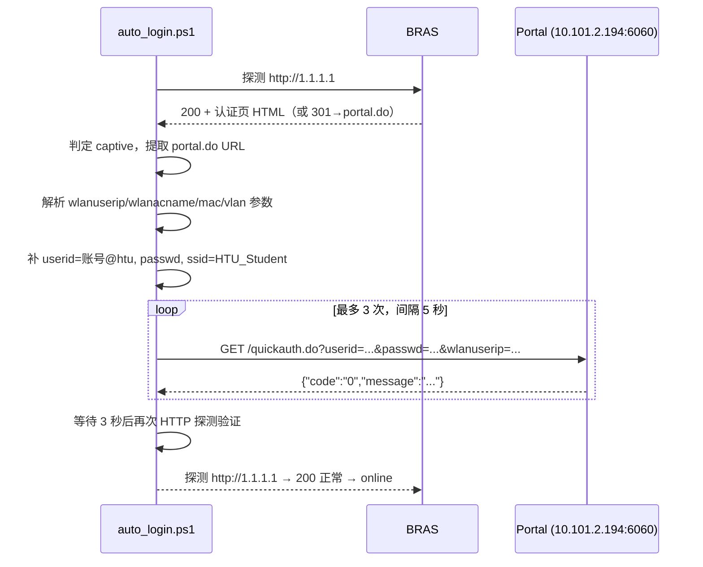

# 原理说明：校园网自动认证保活系统

> 本文档解释整套系统"为什么能自动恢复网络和远程控制"的原理，包括校园网认证机制、断网探测逻辑、认证提交流程与保活设计。适用于河南师范大学 `HTU_Student` 校园网。

---

## 1. 要解决的问题

办公室工位电脑在以下场景中会"失联"：

- 电脑重启 / 断电恢复（WiFi 重新连接，但认证状态丢失）
- 校园网突然断网 / 认证过期 / 被踢下线
- 远程控制软件（网易 GameViewer）因此无法上线

核心矛盾：**网络"连上了"不等于"能上网"**。WiFi 连接只是链路层通，外网访问还需要通过校园网的 Portal 认证。

系统目标：让电脑自己发现"未认证"状态，自动完成认证，全程无需人工到场。

---

## 2. 校园网认证机制（HTU_Student）

### 2.1 网络形态

| 项 | 值 |
|---|---|
| SSID | `HTU_Student` |
| 加密 | Open（无 WPA 密码） |
| 获取 IP | DHCP（未认证也能拿到内网 IP） |
| 外网访问 | 被 BRAS 拦截，必须 Portal 认证 |
| 认证系统 | 深澜 Srun Portal |

连上 WiFi → 拿到内网 IP（如 `10.104.x.x`）→ 此时浏览器访问外网会被劫持到认证页 → 输入学号密码完成认证 → BRAS 放行外网。

### 2.2 认证系统关键接口

| 接口 | 作用 |
|---|---|
| `http://10.101.2.194:6060/portal.do` | 认证登录页（展示给浏览器） |
| `http://10.101.2.194:6060/quickauth.do` | **认证提交接口**（GET，明文参数） |

账号格式：学生 `学号@htu`（如 `2023000000@htu`）；教职工 `@htu.edu.cn`；运营商 `@yd/@lt/@dx`。

认证请求示例（关键参数）：

```
GET /quickauth.do?userid=2023000000@htu&passwd=xxx
    &wlanuserip=10.104.0.10&wlanacname=HSD-BRAS-2
    &mac=aa:bb:cc:dd:ee:ff&vlan=19953605
    &ssid=HTU_Student&hostname=desktop-example
```

返回 `{"code":"0",...}` 表示认证成功。

> 安全说明：该校认证协议为**明文 HTTP + GET 参数**（无 RSA 加密、无图形验证码、无动态 token），这是协议固有特性，不是本脚本引入的。密码只存在本地 `config.ini`，不进 git、不上传任何第三方。

### 2.3 BRAS 劫持的两种方式（本项目最关键的知识点）

未认证时，BRAS 对任意 HTTP 外网请求的处理有两种：

1. **3xx 重定向**：返回 301/302，`Location` 指向 `portal.do` 完整 URL（含 `wlanuserip`、`mac`、`vlan` 等会话参数）。
2. **200 + 认证页 HTML（透明劫持）**：直接返回 HTTP 200，但响应体是认证页 HTML。

> ⚠️ 曾踩坑记录：脚本最初只检查 HTTP 状态码，把第二种情况的 200 误判为"在线"，导致"明明没登录却显示有网"、跳过认证。修复方式见第 3 节——**200 也要读响应体检查特征**。

### 2.4 为什么 ping 不可靠（另一个关键坑）

校园网 BRAS **放行 ICMP 但拦截 HTTP**：

```
未认证时：ping 223.5.5.5 → 通（ICMP 放行）
未认证时：浏览器访问 1.1.1.1 → 被劫持到认证页（HTTP 拦截）
```

所以"ping 通"≠"能上网"。早期版本用 ping 判断在线，导致断网时误判为在线、跳过认证。**最终判定一律使用 HTTP 探测，ping 仅作辅助诊断。**

---

## 3. 探测原理：Http-Probe 三态判定

脚本每次运行，对探测地址发起 HTTP 请求（**不跟随重定向**），根据结果分三态：

```
                         探测 http://1.1.1.1（及备用地址）
                                    │
                 ┌──────────────────┼───────────────────┐
                 │                  │                   │
              连接失败            返回 3xx            返回 2xx
                 │                  │                   │
              offline            Location 头         读取响应体前 8KB
              （无网络）           是否含 portal        是否含 portal 特征
                 │              portal/login/auth     (portal.do/quickauth/
                 │                  │                   wlanuserip/10.101.x)
                 │            ┌─────┴─────┐                 │
                 │        含特征         不含特征          ┌─────┴─────┐
                 │         (captive)     (online)     含特征      不含特征
                 │      需要认证       能上网        (captive)   (online)
                 │                                   需要认证    能上网
                 ▼
            返回 offline / captive / online
```

判定规则汇总：

| 探测结果 | 判定 | 含义 |
|---|---|---|
| 连接失败 | `offline` | WiFi 未连接或 DHCP 未完成 |
| 3xx + Location 含 portal 特征 | `captive` | 未认证，需要提交认证 |
| 3xx + Location 非认证页 | `online` | 正常跳转（如 http→https），能上网 |
| 2xx + 响应体含 portal 特征 | `captive` | **未认证（透明劫持）**，需要提交认证 |
| 2xx + 响应体正常 | `online` | 已认证，能上网 |

双地址探测：`CaptiveUrl`（`http://1.1.1.1`）为主探测，连接失败时换 `FallbackUrl`（`http://www.msftconnecttest.com/connecttest.txt`）兜底，避免单点误判。

被劫持页面中还会**提取完整 portal.do URL**（页面里 `location.href` / meta refresh 指向的地址），用于下一步认证时获取会话参数。

---

## 4. 认证流程

判定为 `captive` 后，脚本按以下步骤完成认证：



要点：

- **会话参数动态获取**：`wlanuserip`、`vlan` 等来自劫持页 URL，DHCP 换 IP 后无需改配置。
- **重试与退避**：单次执行最多 3 次提交、间隔 5 秒，避免对认证服务器造成压力。
- **提交后验证**：认证返回成功后再次探测确认真的能上网，不盲目相信返回码。

---

## 5. 保活机制（Windows 任务计划）

```
CampusAutoLogin（SYSTEM 权限）
├── 触发器 1：开机后延迟 30 秒启动
├── 触发器 2：每 1 分钟重复一次
└── 运行：auto_login.ps1（隐藏窗口）
```

| 设计点 | 原因 |
|---|---|
| SYSTEM 权限运行 | 不依赖用户登录 Windows，开机即跑；远程场景下电脑可能无人登录 |
| 每 1 分钟一次 | 断网/认证过期后最多 1 分钟恢复，及时且不给服务器压力 |
| 开机延迟 30 秒 | 等 WiFi 连接和 DHCP 完成 |
| 单实例 / 执行限时 5 分钟 | 防止并发重复认证 |
| 隐藏窗口 | 不干扰桌面 |

每次运行 = 一次完整"探测 → 必要时认证 → 验证"周期。

**日志模式**（`config.ini` 的 `LogMode`）：

| 模式 | 行为 |
|---|---|
| `normal` | 每次运行写一条（含在线状态），方便盯日志排查 |
| `heartbeat` | 在线时按 `HeartbeatMinutes`（默认 30 分钟）写一条，防刷屏 |

---

## 6. 系统总览

```
┌──────────────────────────────────────────────────────┐
│  Windows 11 (SYSTEM 权限)                            │
│  ┌──────────────┐   每1分钟   ┌───────────────────┐  │
│  │ 任务计划      │──────────→ │ auto_login.ps1    │  │
│  │ CampusAutoLogin│           │ ① Http-Probe 探测 │  │
│  └──────────────┘            │ ② captive? 提交认证│  │
│                              │ ③ 验证 → 日志      │  │
│  └──────────────┘            └───────────────────┘  │
│  GameViewerService（开机自启，出站连接，NAT后可控）   │
└──────────────────────────────────────────────────────┘
         ▲ WiFi (HTU_Student, Open)
         │
┌────────┴─────────┐
│ BRAS + 深澜 Portal│  ← 未认证时劫持 HTTP；放行 ICMP
└──────────────────┘
```

远程控制之所以"失联"，是因为认证失效导致网络不通；一旦脚本保证网络在线，GameViewer 的出站长连接就能保持/恢复，远程设备即可连回。

---

## 7. 边界与已知限制

| 限制 | 说明 |
|---|---|
| 手机热点不可用 | 热点下 `10.101.2.194` 不可达，脚本不认证（环境限制，非缺陷）。**测试必须在 `HTU_Student` 下进行** |
| 验证码/短信/token | 本校园网无验证码，可全自动；若学校启用则需人工介入 |
| 明文密码 | 校园网协议固有（内网明文 HTTP）；密码仅存本地 `config.ini`（git 忽略） |
| IP 变化 | 自动从劫持 URL 获取新参数，无需改配置 |
| 学校策略 | 若校方禁止脚本自动认证或检测异常行为，可能被限制；当前校内"无禁止" |

---

## 8. 验证手段

- **回归测试**（离线可跑）：`scripts\tests\test_captive_detection.ps1`，本地模拟两种劫持方式，验证探测判定 7 个用例全部通过。
- **真实验收**：连 `HTU_Student` → 断开重连 → 日志出现"检测到未认证 → 提交 quickauth.do → 认证成功"。
